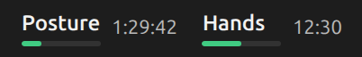
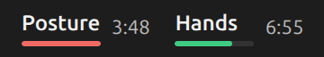
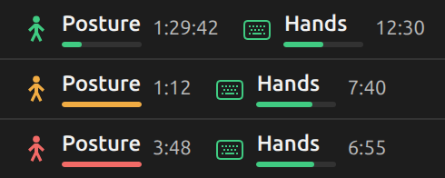
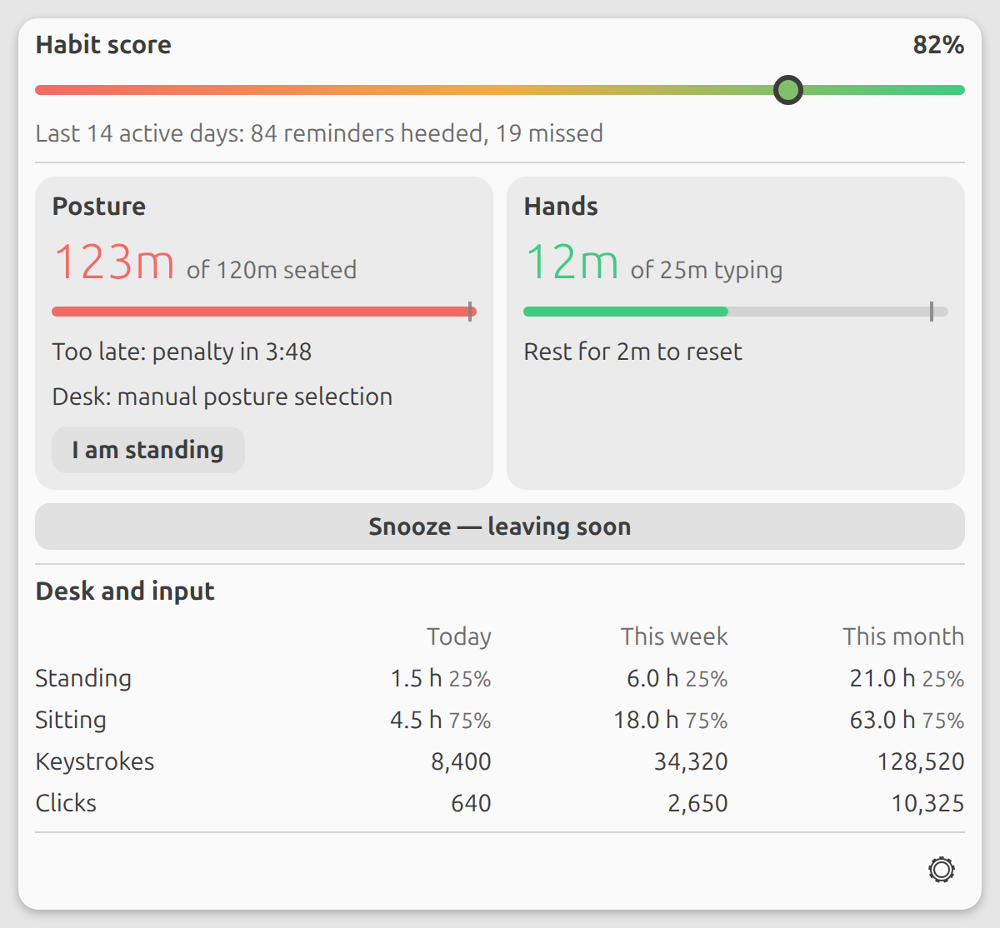
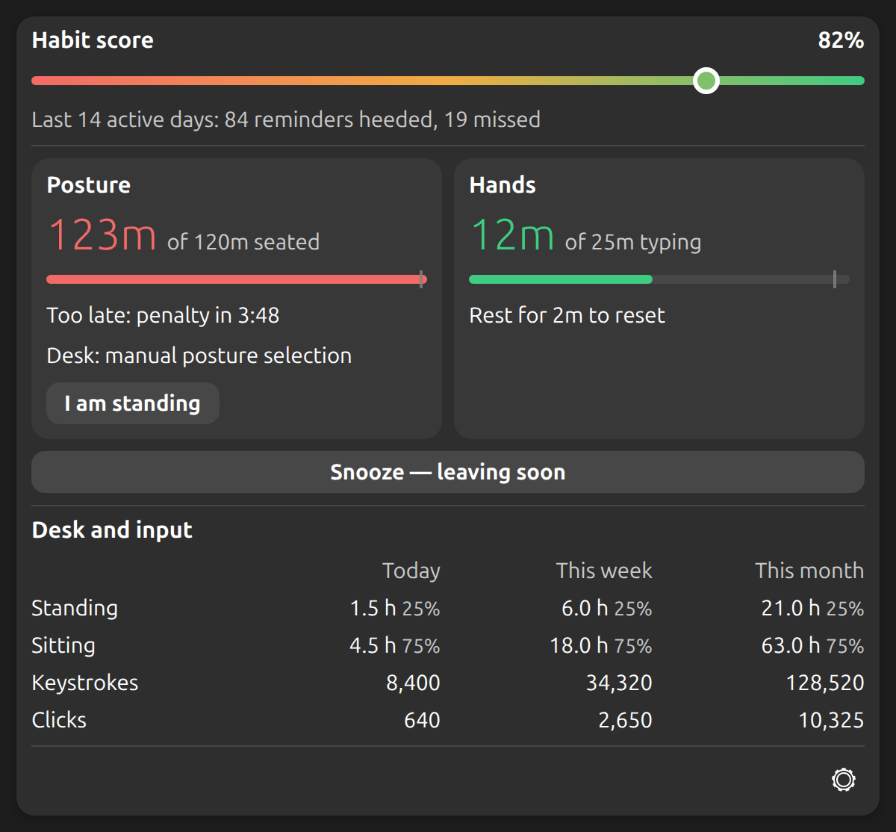

# work-habbits

**v1.1.0** · [Release notes](docs/releases/v1.1.0.md)

A small GNOME extension for desk posture, movement breaks, and keyboard/mouse activity. The top bar shows posture and hands progress bars; the menu keeps colored posture and hands cards, a habit score graph, and daily/weekly/monthly totals. Activity stays on your computer; there are no accounts, telemetry, HTTP clients, or remote control endpoints.

## Previews

Rendered previews of the interface with sample data. They are not desktop screenshots. Click an image to view it at full size.

### Top bar

Posture and Hands each show a label, a bar that fills toward the next change, and the time left.

| Plenty of time | Change due | Too late |
| --- | --- | --- |
|  |  |  |

| Snoozed | Hands unavailable | Optional icons |
| --- | --- | --- |
|  |  |  |

### Menu

The menu brings posture and hand reminders, the habit score, and activity totals together in both themes.

| Light theme | Dark theme |
| --- | --- |
| [](docs/previews/menu-light.png) | [](docs/previews/menu-dark.png) |

## Compatibility

**Desktop-tested on Ubuntu 24.04 LTS, GNOME Shell 46, Xorg.** Other combinations below are expected to work from the documented APIs and compatibility checks; they have not been desktop-tested.

| Setup | Status | Features |
| --- | --- | --- |
| Ubuntu 24.04 LTS, GNOME 46, Xorg | Tested | Posture, movement breaks, typing and clicking counts |
| GNOME 46–48 on Xorg, other Linux distributions | Expected; untested | Same features, with the prerequisites below |
| GNOME 46–50 on Wayland, including Ubuntu 26.04 LTS / GNOME 50 | Expected; untested | Posture and movement breaks; **no typing/clicking counts or automatic hand reminders** |
| Other GNOME versions; KDE, Xfce, MATE; Windows/macOS | Not supported | Contributions welcome |

Requirements: Python 3.11+, GTK 4 with libadwaita 1.4+ bindings, GSettings, a local GNOME graphical session, and systemd user services. Optional Bluetooth requires BlueZ 5.55+ and a compatible desk. Input counts additionally require a full Xorg session with X11 RECORD; XWayland cannot provide complete desktop input counts.

The compatibility assessment follows the [GNOME 47](https://gjs.guide/extensions/upgrading/gnome-shell-47.html), [48](https://gjs.guide/extensions/upgrading/gnome-shell-48.html), [49](https://gjs.guide/extensions/upgrading/gnome-shell-49.html), and [50](https://gjs.guide/extensions/upgrading/gnome-shell-50.html) porting guides. Ubuntu 26.04 ships [GNOME 50 on Wayland](https://documentation.ubuntu.com/release-notes/26.04/changes-since-previous-interim/); upstream GNOME 50 removes the X11 session. The extension handles both widget-orientation and theme-color APIs used across these versions.

Please submit a **pull request** with improvements, fixes, or compatibility results. Include the distribution, GNOME version, session type, and what you tested. Expected compatibility is not a guarantee of hardware behavior.

## Desk modes

| Mode | How it works |
| --- | --- |
| **Manual** (default) | Move your desk yourself, then select **I am standing** or **I am sitting**. No Bluetooth connection. |
| **Bluetooth** | Read height and explicitly raise/lower a TiMOTION TWD1-compatible Nordic UART desk. Requires its Bluetooth address. |
| **Disabled** | For a fixed desk. Select **Start movement break** before a walk, then **Back at desk** when you return. No desk commands. |

Input counts work independently of Bluetooth availability on Xorg. Pausing **Tracking** stops input collection and the Bluetooth helper. On Wayland, the hands indicator explains that input counts need Xorg.

## Install

Use a terminal in your active local GNOME desktop session, without sudo. On Ubuntu, install prerequisites once:

```bash
sudo apt install python3-venv python3-gi gir1.2-adw-1 libglib2.0-bin gstreamer1.0-plugins-base-apps
```

From the checkout:

```bash
./install.sh
```

For optional Bluetooth support, use `./install.sh --bluetooth` instead, or run it later. Python packages stay in the application's virtual environment: `python-xlib` and `six`, plus `bleak` and `dbus-fast` with Bluetooth enabled. There is no JavaScript dependency installation or build framework.

Log out and back in to load the extension. On Xorg, **Alt+F2 → restart → Enter** also reloads Shell. Updated JavaScript modules need a Shell reload. Wayland does not support an in-place Shell restart.

Open **Settings** in the panel menu to select a desk mode, adjust heights, reminder times and the reminder sound, or reset defaults. Settings survive reinstalls. New installations and reset defaults use manual mode; Bluetooth is opt-in.

Installation paths:

- Extension: `${XDG_DATA_HOME:-~/.local/share}/gnome-shell/extensions/work-habbits@local`
- Helpers and Python environment: `~/.local/share/work-habbits`
- Service: `${XDG_CONFIG_HOME:-~/.config}/systemd/user/work-habbits-desk.service`
- Preferences: GSettings schema `org.gnome.shell.extensions.work-habbits`

Install/uninstall manage only work-habbits. Other applications, extensions, services, settings, and history stay untouched. Only one application should control a physical Bluetooth desk at a time. work-habbits can use an existing connection to the configured desk, including one made through GNOME Bluetooth or `bluetoothctl`. It does not force a disconnect before attaching. While tracking, its Bluetooth client manages that connection and releases it when stopped.

## Reminders and counts

Configurable defaults:

- After **120 active seated minutes**, remind you to stand or take a movement break; red after 2 more active minutes.
- A **20-minute stand or marked movement break** resets the seated timer. Remind you to return to sitting, with a 2-minute orange warning before red.
- After **25 active input minutes**, remind you to rest your hands; red after one more minute. **2 continuous minutes without hand input** reset this timer.
- Red lasts at most **10 active minutes**: a penalty halfway, another at the end, then the timer for your current posture or your hands starts a new round. An ignored reminder never charges more than two misses per round.

The top bar shows Posture and Hands, each with a bar that fills toward the next change and the time until it. Bars, and the optional icons, are green before a deadline, blink orange slowly when due, blink red fast when too late, and are gray when unavailable. In orange the time counts down to red; in red it counts down to the next penalty.

Orange is silent. When a reminder turns red, a sound plays and repeats every 15 seconds by default while you keep working (once, every 15 or 30 seconds, or every minute; three bundled sounds). Locked, idle and paused time stays silent, and GNOME's Do Not Disturb mutes the sound while the bars keep blinking. Reminders never show desktop banners. Sounds play through `gst-play-1.0`.

Sitting/standing activity totals accumulate while the local desktop is active and idle time is below 60 seconds. A standing break continues without input while the local session is unlocked. A marked walk continues while locked, but pauses when tracking is disabled or the login becomes inactive. Mark your return explicitly; manual posture is your report, not sensor data.

The hand timer runs while input happened within the last 10 seconds. Typing, clicks, and scrolling indicate activity; wheel steps are not clicks. Pointer movement is sampled at most five times per second and does not restart hand activity. Media keys and Super+L do not end a hand break. Key auto-repeat counts as presses.

Locking, switching users/TTYs, and remote sessions stop input collection. A Bluetooth disconnect pauses sensor-based posture timers. Suspend and process downtime never count as inferred activity. Daily totals and reminder progress persist across extension restarts and start anew each local calendar day.

Tracking can be paused in Settings; this pauses collection, reminders and the Bluetooth helper while keeping history. The menu shows a **Snooze — leaving soon** button while a reminder is orange or red, once per round. Like Workspace Monitor, it snoozes standing/sitting reminders for 15 minutes and hand reminders for 10 minutes (configurable): the bar stays steady orange, the sound stops, and penalties already charged in this round are taken back. If you are still working when the snooze runs out, a fresh red window starts in which both penalties count twice by default, so at most four misses. Taking the break clears the snooze. Locking, leaving the local session or prolonged idle time cancels the double penalty. Locked and idle time never advances a red window. Snoozes survive Shell restarts.

The red-to-green habit score shows timely breaks divided by all scored reminders over the last 14 active days (configurable). Completing a posture break before red, returning to sitting before red, and resting hands after orange but before red earn points. Doing so in red before the first penalty earns nothing and costs nothing. A red window charges a miss halfway and another at its end, then starts a new round. Ordinary hand rests before a reminder earn no points. Inactive time adds no misses.

## Bluetooth protocol and safety

Bluetooth mode is for **TiMOTION TWD1-compatible Nordic UART desks**. Nordic UART alone does not establish desk compatibility. No device address or device-specific name is distributed.

After installing with `--bluetooth`, list nearby devices without connecting:

```bash
~/.local/share/work-habbits/.venv/bin/python \
  ~/.local/share/work-habbits/desk_monitor.py --scan
```

Confirm your compatible desk's address and enter it in Settings. Scan results remain in your terminal. The desktop's normal Bluetooth permissions apply; no root input reader or input-group membership is required. Another controller or phone app may occupy the connection.

The menu offers **Raise desk**, **Lower desk**, and **Stop the desk**. Reminders never trigger a move automatically. Height is classified at the midpoint of your configured sitting and standing heights (80/112 cm defaults).

- Host writes `6e400002-b5a3-f393-e0a9-e50e24dcca9e`; desk notifies `6e400003-b5a3-f393-e0a9-e50e24dcca9e`.
- Notification byte 3 is height in cm. Software targets are limited to 65–130 cm.
- Up/down frames: `d9 ff 01 63 3c` / `d9 ff 02 60 3a`, every 200 ms. STOP/query is five zero bytes.
- Connecting sends STOP/query to obtain height. **Reconnecting can stop an already-moving desk.**
- Conservative braking margins stop motion before the target to allow for coasting. The target is approximate; use the handset for fine adjustment. Different controllers can coast differently.
- Movement stops after 2 seconds without progress or 60 seconds total. Bluetooth writes have a 2-second timeout. Cancellation attempts STOP; no automatic reverse/correction move follows an overshoot.

Keep the travel path clear and stay at the desk. A failed Bluetooth link can prevent STOP arriving; keep the physical handset available. Software controls do not replace the desk's own collision protection. The protocol reference is [go-Stand-Up-Pls](https://github.com/2easy/go-Stand-Up-Pls); transport uses [Bleak](https://bleak.readthedocs.io/).

## Privacy and history

The X11 RECORD helper receives device events across applications, including password fields, and reduces them in memory to counts and an activity timestamp. It never emits or stores typed text, keycodes, passwords, window titles, or pointer coordinates. Raw event buffers are not logged. One-second summaries travel over a private process pipe.

One aggregate JSON file per local calendar day lives in:

```text
${XDG_STATE_HOME:-~/.local/state}/work-habbits/days/YYYY-MM-DD.json
```

The panel icon shows sitting or standing based on desk height in Bluetooth mode, or your selection in manual mode. Movement breaks are walks explicitly marked in fixed-desk mode; their row is shown only in that mode. Hidden movement-break history is retained. History messages appear in the menu only when saving or reading fails.

Records contain sitting/standing/away seconds, key/click/movement counts, reminder progress/outcomes, and the last hand-input timestamp needed to restore breaks. Weeks start Monday; months follow the local calendar. There is no raw event log, server, or database.

Files have owner-only permissions and are replaced atomically every 30 seconds, on day rollover, and when the extension is disabled. Abrupt shutdown may lose the unsaved interval. Failed saves are retried; unreadable records are reported and preserved. Records remain until you delete them. Back up the directory yourself. Startup cost grows with retained daily records.

Bluetooth status and its command socket live in the owner-only `$XDG_RUNTIME_DIR/work-habbits` directory. Other programs running as your user are trusted and can access that user's data and local commands. SSH/TTY input does not count. A remote client mirroring the existing local desktop can see its indicators and inject indistinguishable input.

## Troubleshooting and uninstall

```bash
./status.sh
gnome-extensions info work-habbits@local
journalctl --user -u work-habbits-desk.service -n 30 --no-pager
```

Diagnostic output can include local paths, Bluetooth addresses, and activity totals; inspect it before sharing. Bluetooth status being absent/stale is normal in manual/disabled mode. The service runs a settings watcher; a running service does not imply a connected desk. The panel shows live totals; disk snapshots update every 30 seconds.

Reinstall/reload for missing helpers. Verify typing and clicking increase counts on Xorg, then confirm two minutes of rest resets the hand timer. Check manual posture toggles, pause/resume before testing Bluetooth with clear travel space and an accessible handset. Simulated tests cannot certify hardware behavior.

Uninstall with `./uninstall.sh`. History and preferences remain. To reset preferences while installed:

```bash
gsettings --schemadir ~/.local/share/work-habbits/schemas \
  reset-recursively org.gnome.shell.extensions.work-habbits
```

Delete the work-habbits history directory separately if you want to discard it.

## One-time import from Workspace Monitor

Keep Work Habbits disabled during the import so its in-memory history cannot overwrite imported records. Preview first, then apply:

```bash
python3 scripts/import_workspace_monitor.py
python3 scripts/import_workspace_monitor.py --apply
```

The importer uses the applications' directories under `${XDG_STATE_HOME:-~/.local/state}`; `--source` and `--target` override them. It imports daily posture and input counts, heeded reminders, and already-scored penalties, and translates reminder progress. It never changes Workspace Monitor's files. Today's source record is the last saved snapshot; stop Workspace Monitor first for a final save when switching tools.

Existing dates stop the import by default. After checking for overlapping tracking, `--overlap max` keeps the larger value of each metric for those dates. This avoids counting overlapping activity twice; disjoint activity on the same day needs manual reconciliation. Workspace Monitor supplies reminder progress so a brief overlap with a fresh Work Habbits installation does not reset established timers.

Owner-only backups of both applications' original records, the import plan, and a manifest are kept in `work-habbits/imports/workspace-monitor/`. These preserve fields not mapped by the importer, including working time and original snooze snapshots. A journal prevents a second import from overwriting subsequent activity; an interrupted import also stops for manual recovery using these backups. Enable Work Habbits after a successful import.

## Development and publication

[CONTRIBUTING.md](CONTRIBUTING.md) covers checks, previews, and GitHub setup. [SECURITY.md](SECURITY.md) covers vulnerability reporting. GitHub checks code style, security lint, shell/JavaScript syntax, schemas, behavior, and dependency advisories on pushes/PRs and weekly. Dependabot proposes weekly updates. `make dist` creates a source archive that excludes local configuration and caches.

Licensed under [MIT](LICENSE). Bundled notification sounds are third-party Pixabay content; see [THIRD_PARTY_NOTICES.md](THIRD_PARTY_NOTICES.md).
